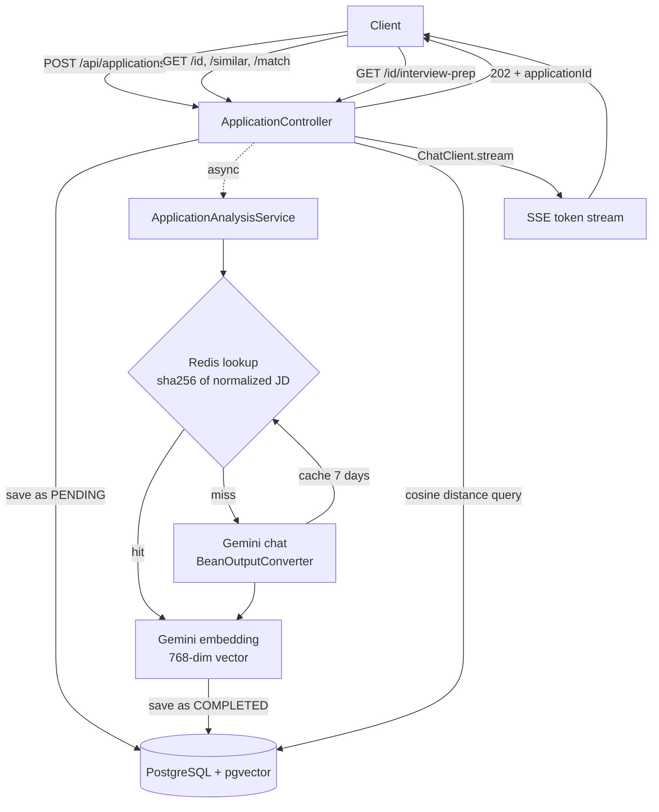

# Job Application Intelligence Platform

> Spring Boot 4 + Spring AI backend that turns a pasted job description into structured data, finds similar JDs with pgvector, scores your skills against a role, and streams tailored interview questions.

[](https://github.com/krishnaaarwal/job-application-intelligence-platform/actions)


---

## What it does

1. **Submit a JD** → returns `202 Accepted` immediately; analysis runs in the background.
2. **Structured extraction** → Gemini returns core requirements, responsibilities, tech stack and experience level, parsed into a Java record with `BeanOutputConverter`.
3. **Embedding** → the requirements and tech stack are embedded (768 dimensions) and stored in PostgreSQL with `pgvector`.
4. **Similar JDs** → cosine-distance search over stored embeddings, no keyword matching.
5. **Skill match score** → embeds your skills text and compares it with the JD's embedding.
6. **Interview prep** → streams tailored questions token by token over SSE.

---

## Architecture



---

## Key engineering decisions

**1. Async 202 + polling.** `POST /api/applications` saves a `PENDING` row and hands the work to a Spring `@Async` thread. The client polls `GET /api/applications/{id}` until the status is `COMPLETED` or `FAILED`.

**2. Schema-guided extraction.** `BeanOutputConverter` adds the JSON schema of the `JdAnalysis` record to the prompt and parses the model's reply into that record. Any parsing or API failure marks the application `FAILED` instead of leaving it stuck.

**3. Normalized-content cache.** The JD is lowercased and everything except letters and digits is stripped before hashing with SHA-256 (`jd_analysis:<hash>`, 7-day TTL). The same JD pasted with different spacing or punctuation costs one chat call, not two. The Testcontainers test asserts exactly that. This is an exact match on normalized text, not a semantic cache.

**4. Embed only what matters.** Only `coreRequirements` and `techStack` are embedded, not the whole JD, so company-culture text doesn't dilute the vector.

```sql
SELECT * FROM applications a
WHERE a.id != :targetId AND a.jd_embedding IS NOT NULL
ORDER BY a.jd_embedding <=> cast(:embeddingStr as vector)  -- cosine distance
LIMIT 5;
```

**5. Custom `GeminiEmbeddingModel`.** I implemented Spring AI's `EmbeddingModel` against the Gemini embedding API. At first use it auto-detects an available embedding model instead of hardcoding a model name.

**6. SSE streaming.** `ChatClient.stream()` returns a `Flux<String>` served as `text/event-stream`, so the client sees text as it is generated instead of waiting for the full response.

---

## API

| Method | Endpoint | Description |
|--------|----------|-------------|
| POST | `/api/applications` | Submit `companyName` + `rawJd`; returns `202` and `applicationId` |
| GET | `/api/applications/{id}` | Status (`PENDING` / `COMPLETED` / `FAILED`) and extracted data |
| GET | `/api/applications/{id}/similar` | Up to 5 closest JDs by cosine distance |
| GET | `/api/applications/{id}/match?skills=...` | Similarity score between your skills text and the JD |
| GET | `/api/applications/{id}/interview-prep?skills=...` | SSE stream of interview questions targeting your skill gaps |

```bash
# Submit
curl -X POST localhost:8080/api/applications \
  -H "Content-Type: application/json" \
  -d '{"companyName":"Razorpay","rawJd":"Backend engineer, 2+ years Java, Spring Boot, PostgreSQL..."}'
# {"applicationId":"a1b2c3d4-..."}

# Poll
curl -s localhost:8080/api/applications/$ID | jq '{status, extractedData}'

# Match (use --data-urlencode for spaces)
curl -s -G localhost:8080/api/applications/$ID/match \
  --data-urlencode "skills=Java, Spring Boot, Redis, Docker"
# {"matchPercentage": <0-100>}

# Stream interview prep (-N disables curl buffering)
curl -N -G localhost:8080/api/applications/$ID/interview-prep \
  --data-urlencode "skills=Java, Spring Boot"
```

Example `extractedData`:

```json
{
  "coreRequirements": ["3+ years of backend experience", "Java", "Spring Boot", "PostgreSQL"],
  "responsibilities": ["Building REST APIs", "Writing JUnit tests", "Optimizing database queries"],
  "techStack": ["Java", "Spring Boot", "PostgreSQL", "JUnit", "Docker", "Redis"],
  "minimumExperienceLevel": "3+ years"
}
```

---

## Getting started

**Prerequisites:** Java 21, Docker, a Gemini API key ([ai.google.dev](https://ai.google.dev)).

```bash
git clone https://github.com/krishnaaarwal/job-application-intelligence-platform.git
cd job-application-intelligence-platform

docker compose up -d        # PostgreSQL + pgvector, and Redis
export SPRING_AI_GOOGLE_GENAI_API_KEY=your_key_here
./mvnw spring-boot:run
```

The API is at `http://localhost:8080`. The `vector` extension is created automatically by an init script mounted into the Postgres container (it only runs on a fresh volume; use `docker compose down -v` to reset).

| Service | Port |
|---------|------|
| API | 8080 |
| PostgreSQL | 5440 |
| Redis | 6385 |

### Tests

```bash
./mvnw verify
```

The integration test starts real `pgvector/pgvector:pg17` and `redis:7-alpine` containers with Testcontainers. Only the Gemini chat and embedding calls are mocked, so no API key is needed. It checks that a JD is analyzed to `COMPLETED`, that the same JD in different formatting is served from Redis (one LLM call), and that a single cache entry exists.

---

## Known limitations

- **Gemini latency varies.** On the free tier, calls sometimes take minutes, during which the status stays `PENDING`. Spring AI's built-in retry handles 429/5xx responses.
- **Jobs aren't durable.** `@Async` runs in-process, so a restart mid-analysis leaves the row `PENDING`.
- **The cache saves the chat call only.** The embedding is still generated for every submission.
- **The match score is a relative signal.** It is cosine similarity between embedded text, not a calibrated percentage. It is useful for comparing JDs against the same skills, not as an absolute "you're 87% qualified".
- **No authentication.** Built as a single-user/local service.

---

## Project structure

```
src/
├── main/java/com/example/JobApplicationIntelligencePlatform/
│   ├── config/       GeminiEmbeddingModel
│   ├── controller/   ApplicationController (REST + SSE)
│   ├── dto/          ApplicationRequest
│   ├── entity/       Application (vector(768) column), JdAnalysis (record)
│   ├── repository/   ApplicationRepository (native pgvector queries)
│   ├── service/      ApplicationAnalysisService (async pipeline, cache, embeddings)
│   └── types/        AnalysisStatus
└── test/
    ├── java/.../ApplicationAnalysisServiceTest.java
    └── resources/init-vector.sql
```

## Tech stack

| Layer | Technology |
|-------|-----------|
| Runtime | Java 21, Spring Boot 4.1 |
| AI | Spring AI 2.0 (ChatClient, BeanOutputConverter), Gemini |
| Vector search | PostgreSQL 17 + pgvector, Hibernate Vector |
| Cache | Redis |
| Streaming | Server-Sent Events, Reactor `Flux` |
| Testing | JUnit 5, Testcontainers, Awaitility, Mockito |
| CI / Infra | GitHub Actions, Docker Compose |

---

## Author

**Krishna Agarwal** · 3rd-year B.Tech CSE, AKGEC Ghaziabad

[](https://github.com/krishnaaarwal)
[](https://linkedin.com/in/krishna-agarwal-9b2a06367)